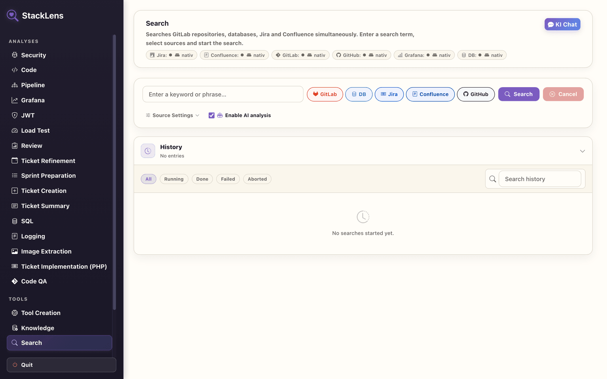

# StackLens

StackLens is a Kotlin/Spring Boot workbench for development teams. Cross-system keyword search is the
entry point, not the whole product: on top of it sit AI-powered analyses for code quality, security and
bug hunting, merge/pull-request review, tickets, sprints, CI/CD pipelines, SQL, logs, load tests,
Grafana dashboards, JWTs and images (OCR) — plus a RAG knowledge database, generated Kotlin tooling, a
contextual AI chat and a bundled MCP server, all behind one interface. It runs as a JavaFX desktop app
with an embedded web UI (`http://localhost:8090`), or as a plain server JAR.

**This README is the short version.** Everything that was trimmed out of it — the full feature guide,
configuration tables, every environment variable, AI provider internals, testing, code quality,
packaging and project structure — lives in **[docs/INTERNALS.md](docs/INTERNALS.md)**.



*The search page with the UI language set to English, running against a fresh database — no
connections, no results, no history.*

---

## Prerequisites

| Start option | Requires | Install |
|---|---|---|
| **A — `./start.sh`** (recommended) | JDK 25, Git, curl (macOS/Linux) | JDK: [Adoptium Temurin](https://adoptium.net/) or `sdk install java 25-tem`; Git/curl are pre-installed on macOS, otherwise `sudo apt install git curl`. Gradle itself is downloaded by `./gradlew`. |
| **B — Docker Compose** | Docker Desktop 4.x | [docker.com/get-started](https://www.docker.com/get-started/) |
| **C — MCP server** | Node.js 20, npm 10 | [nodejs.org](https://nodejs.org/) or `nvm install 20` (npm ships with Node.js) |

Officially tested on **Ubuntu 24.04** and **Pop!_OS 24.04**.

---

## Quick start

### Option A — `start.sh` (Linux & macOS)

```bash
./start.sh                # first run builds the JAR, later runs reuse it
./start.sh --rebuild      # force a fresh build
```

Server starts on **http://localhost:8090**; the browser opens automatically on macOS — on Linux, open
the URL manually once the `Server is up` message appears.

```bash
SERVER_PORT=9090 ./start.sh            # override the port
JAVA_HOME=/path/to/jdk ./start.sh      # override the JDK
```

`start.sh` loads `.env` from the repository root first (copy [.env.example](.env.example)); exported
shell variables always win.

### Option B — Docker Compose

```bash
docker compose up -d                          # StackLens on http://localhost:8090
docker compose --profile demo up -d           # + demo mocks (Jira, GitLab, Grafana, MySQL)
docker compose logs -f stacklens              # logs
docker compose down                           # stop
```

> Port 3000 already taken on the host? Set `GRAFANA_DEMO_PORT` in `.env` — see
> [docs/INTERNALS.md → Docker demo stack notes](docs/INTERNALS.md#docker-demo-stack-notes).

### Option C — MCP server

```bash
cd mcp-server && cp .env.example .env && npm install && npm run build && npm start
```

Runs on `http://localhost:7456`. Enable it in StackLens under **Configuration → MCP** (URL, optional
bearer token, per-provider switches, **Test connection**). If the server is unreachable, StackLens
falls back to the direct adapters. Full setup, tool list and VS Code Copilot config:
[mcp-server/README.md](mcp-server/README.md) and
[docs/INTERNALS.md → MCP server](docs/INTERNALS.md#mcp-server).

---

## What StackLens does

**Systems covered:** GitLab, GitHub, Jira, Confluence, Grafana and databases (PostgreSQL, MySQL,
SQL Server), searched and analysed from one place. **AI backends:** GitHub Copilot CLI, Anthropic
Claude, OpenAI, OpenRouter, Ollama, LM Studio or any OpenAI-compatible endpoint. **Local by design:**
sessions, results and analyses stay in an embedded H2 database, config export/import is AES-256-GCM
encrypted, and the UI is bilingual (EN/DE) with four themes and drag-to-reorder navigation.

| Feature | Purpose | Details |
|---|---|---|
| **New Search** | Parallel keyword search across all connected systems, with cross-references between sources | [↗](docs/INTERNALS.md#1-new-search) |
| **Ticket Analysis** | Jira ticket → implementation plan, code suggestions, test run, auto-created MR/PR; includes Ticket Summary and the 13-agent PHP Agent Pipeline | [↗](docs/INTERNALS.md#2-ticket-analysis) |
| **Code Quality Analysis** | Duplicate code, architecture violations, unused code + AI architecture diagrams (Draw.io, Mermaid) | [↗](docs/INTERNALS.md#8-code-quality-analysis) |
| **Bug Hunting & Security** | Multi-iteration vulnerability scan with exploit analysis, CVSS and generated fixes | [↗](docs/INTERNALS.md#12-bug-hunting--security-analysis) |
| **Code QA** | Review GitLab MRs / GitHub PRs against acceptance criteria and coding guidelines | [↗](docs/INTERNALS.md#3-code-qa) |
| **Pipeline Analysis** | AI inspection of Docker Compose stacks and CI/CD pipelines across 10+ file types | [↗](docs/INTERNALS.md#13-pipeline-analysis) |
| **Sprint Analysis / Sprint Preparation** | Sprint retrospectives as MD/HTML; AI ticket-quality review before planning | [↗](docs/INTERNALS.md#9-sprint-analysis) |
| **Tooling Analysis** | Prose or script description → standalone executable Kotlin JAR, with AI compile-retry | [↗](docs/INTERNALS.md#5-tooling-analysis) |
| **Grafana Analysis** | Extract metrics/queries from dashboards; AI dashboard rebuild | [↗](docs/INTERNALS.md#6-grafana-analysis) |
| **SQL Analysis** | Query optimisation, test-data generation, query authoring from DDL | [↗](docs/INTERNALS.md#10-sql-analysis) |
| **Load Test Analysis** | PHP bottleneck detection + generated k6/JMeter scripts, runnable from the UI | [↗](docs/INTERNALS.md#11-load-test-analysis) |
| **Logging** | Classify pasted log output locally, then a 4-stage AI fix pipeline writing into a linked repo | [↗](docs/INTERNALS.md#14-logging) |
| **JWT Analysis** | Server-side token decoding and validation — nothing leaves the server | [↗](docs/INTERNALS.md#7-jwt-analysis) |
| **Image Extraction** | OCR text from TIFF/PNG/JPG: multimodal AI with a local Tesseract fallback | [↗](docs/INTERNALS.md#image-extraction) |
| **AI Chat** | Contextual assistant drawer on every analysis page, pre-loaded with page context | [↗](docs/INTERNALS.md#ai-chat) |
| **Knowledge Database** | RAG index (Lucene KNN) over files, Confluence/Jira and published analyses | [↗](docs/INTERNALS.md#knowledge-database) |
| **Docker Test** | One-click start/reset of the demo Compose stack and its JSON fixtures | [↗](docs/INTERNALS.md#docker-test-environment-developer-option) |
| **MCP Server** | Bundled Model Context Protocol server exposing all providers as MCP tools | [↗](docs/INTERNALS.md#mcp-server) |

---

## Development

```bash
./gradlew clean build          # build everything
./gradlew bootRun              # run the JavaFX desktop app
./gradlew clean bootJar && java -jar build/libs/*.jar   # server mode
./gradlew test                 # Kotlin unit + integration tests
./gradlew testFrontend         # Vitest frontend specs
./gradlew testE2e              # Playwright end-to-end suite
./gradlew ktlintFormat         # code style
./gradlew buildLinuxDeb        # packaging (also: buildMacInstaller)
```

Hexagonal architecture (domain → application → adapter → infrastructure), enforced by ArchUnit;
Kotlin coverage is verified at 100 % line and branch coverage. Task list, test inventory, coverage
exclusions, e2e browser handling, installer details and the annotated directory tree:
[docs/INTERNALS.md](docs/INTERNALS.md).

---

## Configuration

Main files: `src/main/resources/application.yml` (base) and `application-standalone.yml` (desktop
overrides); most values are environment-variable placeholders.

| Variable | Default | Purpose |
|---|---|---|
| `SERVER_PORT` | `8090` | HTTP port |
| `JAVA_HOME` | system JDK 25 | JDK used by `start.sh` |
| `AI_PROVIDER` | `auto` | AI backend before the first AI config exists: `copilot`, `ollama`, `lmstudio`, `openai`, `openrouter`, `claudecode`, `compatible` |
| `STACKLENS_DATA_DIR` | `./data` | UI prefs, prompt overrides, agent prompts |
| `LOG_LEVEL` | `WARN` | Log level for `com.stacklens` |

Provider API keys (`GITHUB_TOKEN`, `ANTHROPIC_API_KEY`, `OPENAI_API_KEY`, `OPENROUTER_API_KEY`, …),
feature toggles, model discovery, timeout overrides and the full table of ~30 variables:
[docs/INTERNALS.md → Configuration](docs/INTERNALS.md#configuration).

---

## Documentation

| Document | Content |
|---|---|
| **[docs/INTERNALS.md](docs/INTERNALS.md)** | Feature guide, architecture notes, config & env vars, testing, code quality, packaging, project structure, MCP server |
| **In-app `/docs`** | User Guide + Application Documentation (EN/DE) with full-text search |
| [docker/README.md](docker/README.md) | Demo stack, sub-stacks, ports, fixtures |
| [mcp-server/README.md](mcp-server/README.md) | MCP server setup and tool reference |
| [scripts/README.md](scripts/README.md) | Build, packaging and helper scripts |

---

## License

MIT — see [LICENSE](LICENSE).
