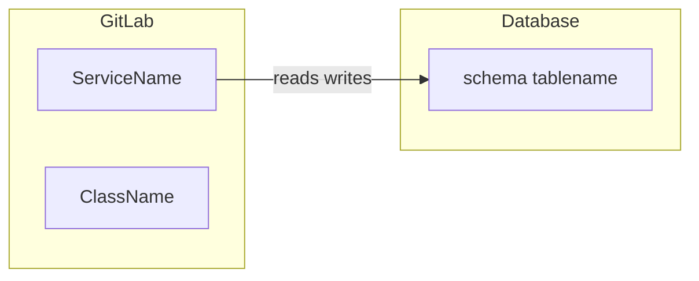

## search.contextHeader
## Search Context

## search.keywordsLabel
- Search terms: {keywords}

## search.hitsLabel
- Total hits: {count}

## search.activeSourcesLabel
- Active sources with hits: {sources}

## search.gitlabHeader
## GitLab / Code Hits ({count})

## search.pipelineHeader
## CI/CD Pipeline Hits ({count})

## search.dbHeader
## Database Hits ({count})

## search.confluenceHeader
## Confluence Hits ({count})

## search.jiraHeader
## Jira Hits ({count})

## search.grafanaHeader
## Grafana Hits ({count})

## search.entitiesHeader
## Entity Overview (for relationship analysis)

## search.noEntities
(no entities found)

## search.noDetail
(no details)

## search.outputFormatHeader
## Required Output Format

## search._section.analyse
Analysis Prompt

## search.systemRole
You are a senior software architect and systems analyst.

## search.taskDescription
Your task: Analyse the relationships between the entries found across different source systems.

## search._section.einordnung
Domain Context

## search.section1
### 1. Domain Context
Describe in 3–5 sentences which application/domain is behind the search terms.

## search._section.beziehungen
Relationship Analysis

## search.section2.header
### 2. Relationship Analysis
Concretely analyse which connections exist between the hits from the various sources:

## search.section2.multiSourceBullets
- Which code classes/functions (GitLab) reference which DB tables?
- Which Jira tickets describe requirements implemented in code or DB tables?
- Which Confluence pages document components found in code/pipeline?
- Which pipeline stages deploy components found in the code?
- Which Grafana dashboards monitor DB tables or services from the code?
- Where does the same concept (keyword) appear in multiple systems → that is a confirmed connection

## search.section2.singleSource
- Describe the internal structure and dependencies of the hits from the available source

## search._section.mermaid
Mermaid Diagram

## search.mermaidSection
### {sectionNum}. Relationship Diagram (REQUIRED)
Create a Mermaid diagram showing the relationships between entities across system boundaries.
Use `graph LR`. Show only connections you can derive from the hits — no fabrications.
IMPORTANT for valid Mermaid syntax:
- Node IDs: only letters, digits, underscore. No special characters, no :: in Node IDs.
- FORBIDDEN Node IDs (Mermaid keywords): end, class, style, default, subgraph, graph, LR, TD.
- Node labels in square brackets with quotes may contain readable names.
- Arrow syntax: ONLY --> (two hyphens + >) is valid. FORBIDDEN: -> (one hyphen).
  Wrong: GL1 -> DB1  — Right: GL1 --> DB1
- Edge labels (between | and |): ALWAYS inside pipe characters. FORBIDDEN: quotes, parentheses (), plus signs +, semicolons.
  NEVER write words between two nodes without pipes: GL1 --> reads DB1 is WRONG.
- Correct example: GL1 -->|reads writes| DB1
- Wrong examples: GL1 -> DB1  or  GL1 --> DB1 reads  or  GL1 -->|"reads"/writes| DB1  or  GL1 -->|read(table)| DB1
Format:


## search._section.drawio
Draw.io Diagram

## search.drawioSection
### {sectionNum}. Draw.io Architecture Diagram (REQUIRED)
Create a complete Draw.io diagram in mxfile format showing the system architecture.
Required rules:
- Output as ```drawio code block
- Valid mxfile XML: <mxfile><diagram name="Architecture"><mxGraphModel ...><root>...</root></mxGraphModel></diagram></mxfile>
- Each system component from the hits as mxCell with vertex="1"
- Connections between components as mxCell with edge="1" source and target
- Use swimlane style to separate source systems (GitLab, DB, Jira, etc.)
- Swimlane containers: min. 20px padding; height = number of boxes × 70px + startSize
- All <mxGeometry> must have as="geometry"
- Use only the concrete artifact names from the hits — no fabrications
Format example:
```drawio
<mxfile><diagram name="Architecture"><mxGraphModel dx="1422" dy="762" grid="1" gridSize="10" guides="1" tooltips="1" connect="1" arrows="1" fold="1" page="1" pageScale="1" pageWidth="1654" pageHeight="1169" math="0" shadow="0"><root><mxCell id="0"/><mxCell id="1" parent="0"/>
<!-- Areas, components and connections here --></root></mxGraphModel></diagram></mxfile>
```

## search._section.ausgabe
Output

## search.responsibilitiesSection
### {sectionNum}. Responsibilities per System
Table: Which system ({sources}) fulfils which role in the application?

## search.uncertaintiesSection
### {sectionNum}. Uncertainties / Assumptions
List what you could not unambiguously derive from the data.

## search.importantNote
IMPORTANT: Use only the concrete artifact names from the hits above.
Do not invent names, systems or connections that are not evidenced in the data.
Write your answer directly as Markdown text. Do NOT wrap the entire answer in a code block (no ```markdown or ```text at the start).
